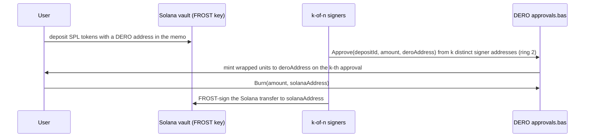
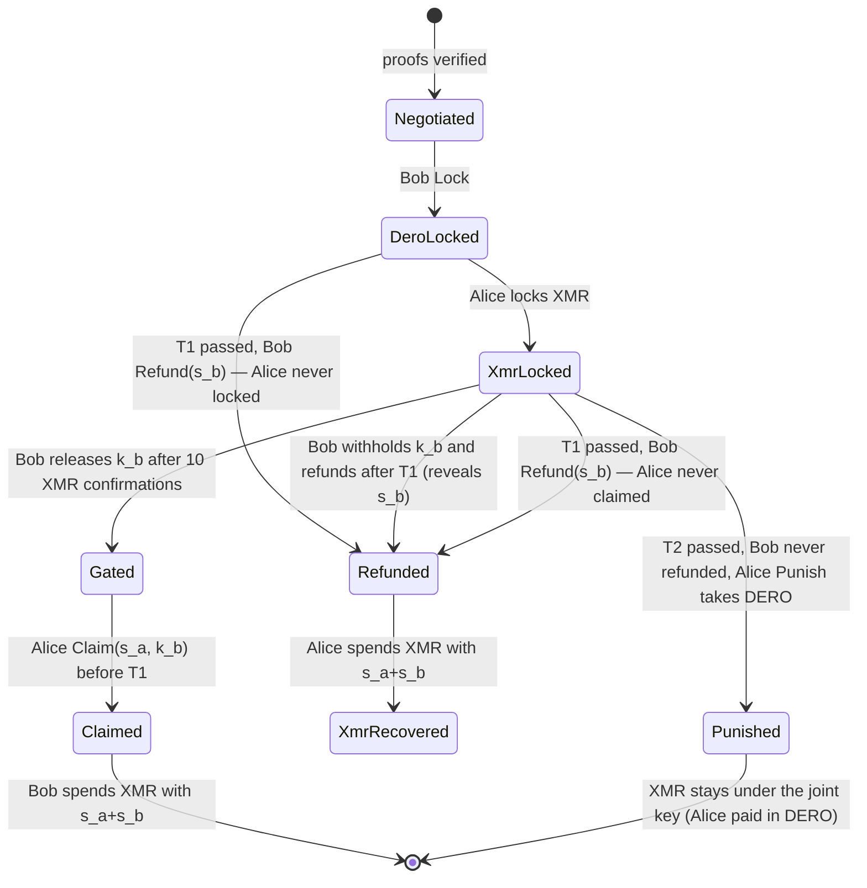

# Cross-chain research: report, feasibility, trust models, primitives, protocol sketches, specification

The technical record. Conclusions are in `README.md`.


---

# REPORT

## Cross-chain feasibility for a TELA-hosted pump.fun / fomo-class DEX — REPORT

Phases 0–3 delivered 2026-09-06. Companion files: `RESEARCH.md (DVM primitives)`, `RESEARCH.md (Feasibility matrix)`, `RESEARCH.md (Trust models)`,
`PROTOCOL_SKETCHES/`, `poc/`, `SOURCES.md`, `README.md (Wrong premises)`. Verdict format per question: Verdict / Mechanism /
Trust assumptions / Prior art / Missing primitives / Confidence.

### Executive verdict (one page)

1. **DERO's VM is a hash-and-height machine** (35 built-ins, all on current mainnet; no signature, curve or
   big-integer operations; no cross-contract calls; no external reads). Everything below follows from it.
2. **Trustless, no-liquidity swaps between DERO and script/program chains are buildable now.** DERO ↔ Solana,
   DERO ↔ EVM, DERO ↔ Zcash-transparent, DERO ↔ Bitcoin-family are plain HTLC↔HTLC swaps. The DERO leg exists and
   ran end to end on the simulator today (`poc/`: lock, claim with a 32-byte preimage, expired claim refused by
   the chain, refund; every txid and gas recorded).
3. **DERO ↔ Monero is possible without an oracle; the blocking proof now exists as a prototype.** Monero has no
   scripts, so the swap ties the DERO hash preimage to a Monero key share; because DERO cannot verify signatures,
   the adaptor-signature construction used by COMIT / eigenwallet / BasicSwap does not apply, and each party needs
   a client-side zero-knowledge proof that "SHA256 of my secret is this hash *and* my secret is the discrete log of
   this ed25519 point". Built on 2026-09-06 (`poc/proof-xmr`, Bulletproofs, no trusted setup): 37,460 gates,
   14.8 s to prove, 1.15 s to verify, 1.6 KB. The same proof on Pallas (`poc/proof-zec`) covers Orchard key
   shares. What remains is engineering: the escrow with a gate secret, the companion, and stagenet runs
   (README.md (Resolved)).
4. **Shielded Zcash is a research item** (no scripts, no adaptor-signature ecosystem yet; the only running design,
   Zwap, is early access and EVM-only). Transparent Zcash is an ordinary script HTLC.
5. **Wrapped foreign assets on DERO require a federation** (threshold signers holding custody on the foreign chain,
   a k-of-n `SIGNER()`-checked approval contract on DERO). It works, it is trusted, and the failure history of that
   model (Wormhole, Ronin, THORChain) is the reference class. A trustless bridge is impossible until DVM-BASIC gains
   ed25519 / secp256k1 verification.
6. **"One-click buy anything cross-chain" cannot be reproduced trustlessly.** fomo does it with custody (one balance,
   Crossmint on-ramp, its own routing). A swap-settled Veil is honest and slower: minutes for Solana, tens of minutes
   for Monero, with both parties online.
7. **mycelium is a messenger.** Reusable as a wallet-driver pattern and a tiny private signalling channel; it has
   no signing, DAO or bridge code. Its whisper could not be driven against the simulator in this study (mainnet
   assumptions in its address handling); the channel verdict stays low-confidence.
8. **Decision after the operator's requirement of instant, pooled XMR/ZEC markets (DECISION.md):** Layer A (built)
   + a bonded k-of-n **federation wrapper** (wXMR/wZEC/wSOL on DERO; `contracts/vault.bas` built and tested;
   Zcash custody via FROST demonstrated) for instant fills, with **atomic swaps as the trustless exit hatch** (SOL
   and transparent ZEC now, XMR and shielded ZEC once the prototyped proofs are integrated).

### Phase 0 (unchanged): Q1 and the DVM audit

See the Phase 0 sections preserved below under "Q1" and `RESEARCH.md (DVM primitives)`.

#### Q1. What is mycelium, really, and what parts are reusable?

**Verdict: established from code (H).** A no-relay, end-to-end encrypted messenger riding transaction payload
fields. Not a chain, not a bridge; no DAO, multisig or threshold-signing functionality.

Mechanism (HEAD `bd6ee947`, 2026-09-05): `internal/chain/chain.go` defines `Chain` = `Name / Address / Height /
PostPayload(recipient, payload, amountHint) / ListIncoming(minHeight)` plus a 3-second `Watch` poller deduplicated
by txid. Backends: DERO (wallet-RPC `transfer` with typed CBOR arguments, ≥ 1 atomic unit of postage, ring size 2,
receive via `get_transfers`), EVM (calldata; `MyceliumMailbox.sol` undeployed), Solana (deployed mailbox program,
per-recipient PDA; client self-messages), Monero (`monero-wallet-rpc` transfer with an 8-byte payment-id "knock").
`internal/whisper`: text ≤ 80 chars (`MaxTextLen`), kinds 0x01 text / 0x02 pointer; derohe's payload field is
`PAYLOAD0_LIMIT = 144` bytes. `internal/secure`: X25519 → HKDF-SHA256 → XChaCha20-Poly1305 envelope for public
chains. Long bodies: sender-held ciphertext fetched by CID through an external `compost-peer` binary from the
non-public `derohe-rs`. "Identity proof" (ROADMAP #7) is unbuilt. The only signer is the Solana fee-payer keypair.
`go build ./...` and `go test ./...` pass (18 packages).

Reusable: (i) the multi-backend wallet-driver pattern, yes; (ii) the private DERO signalling channel, partially
(one line ≤ 80 chars per transaction, ~18 s, sender hidden, both peers online for anything longer; measurement
attempt in experiment 3 failed on mycelium's mainnet-only address handling, see WRONG_PREMISES #9); (iii)
signing/DAO/federation: nothing. Trust: none for confidentiality; the `compost-peer` binary is unaudited and its
source is not public. Confidence H.

### Q2. Can XMR, ZEC or SOL be "hosted inside the DERO wallet"?

**Verdict: Yes (wallet engineering), with one architectural rule: keys never live in the browser tab. Confidence H.**

- **Engram** (DEROFDN, Go + Fyne) is DERO-only with no plugin or multi-chain mechanism visible in its repository;
  adding chains means forking it. Not recommended as the host.
- **Local companion** is the right shape and the one XSWD already established: one local Go process that (a) holds
  the foreign keys encrypted at rest, (b) spawns or connects to `monero-wallet-rpc` and a Solana JSON-RPC endpoint,
  (c) runs the swap state machine with persisted state, (d) exposes a permissioned local WebSocket the TELA app
  talks to exactly as it talks to XSWD (per-app authorisation, prompts for spends). mycelium's `Chain` seam is a
  reasonable starting template for (b); everything in (c) is new.
- **Light-client options and what they leak.** Monero: `monero-wallet-rpc` against a remote `monerod` scans blocks
  locally, so the node learns your IP and which blocks you fetch, not your view key; `monero-lws`-style light
  wallets hand the view key to the server (worse). Zcash: `zcash_client_backend` + `lightwalletd` scan compact
  blocks locally; the server learns IP and timing. Solana: everything is public anyway; the RPC provider learns
  your address and IP. Running your own nodes removes the IP/timing leak and is the privacy-consistent default for a
  DERO user.
- **Why not the browser:** a TELA page runs under a strict CSP but is still a web page; a swap secret or an XMR spend
  key in a tab is one extension or one bug away from exfiltration, and the page cannot keep state across restarts
  reliably enough to refund a crashed swap. The companion pattern also keeps the "wallet asks you to confirm"
  property users already know from XSWD.

Prior art: mycelium (backends), Engram/XSWD (permissioned local socket), eigenwallet (a desktop app that embeds
both wallets and the swap state machine). Missing primitives: none. Trust: the user trusts their own machine and the
nodes they point the companion at.

### Q3. "Send off-chain without a centralised oracle": what could it mean?

**Verdict per reading.**
- (a) **Cross-chain value transfer** = an atomic swap. Yes without an oracle (Q4). Two parties, both online.
- (b) **Payment channels / off-chain settlement on DERO**: **Not on DERO today.** A channel needs the chain to
  enforce an off-chain state (a signed balance update) at close time; the DVM cannot verify a signature, so a DERO
  contract cannot adjudicate a channel. Missing primitive: signature verification in DVM-BASIC.
- (c) **Data channel** (mycelium's whisper / pointer + off-chain body): Yes, no oracle, no third party; it moves
  bytes, not value.

**The blunt statement, with the reason it is true:** a chain can change its state only on facts it can verify
itself. For cross-chain value, the facts are either (i) a secret revealed in a transaction the chain can hash-check
(the swap: atomicity from cryptography) or (ii) a claim signed by parties the chain has been told to trust (the
bridge: atomicity from trust). Any "third option" would need the DERO chain to verify a foreign chain's state,
which requires signature/curve verification it does not have. There is no third option today.

### Q4. Trustless atomic swaps DERO ↔ XMR / ZEC / SOL: exactly what the DERO side needs

**Verdicts:** DERO ↔ SOL: **Yes (H)**. DERO ↔ ZEC-transparent: **Yes (H)**. DERO ↔ EVM: **Yes (H)**.
DERO ↔ XMR: **Yes in principle; not shippable on DERO today (M)** — needs a client-side consistency proof nobody has
built for this pairing. DERO ↔ ZEC-shielded: **Not on DERO today (L)**.

#### 4.1 The DERO side (all pairs)

`poc/swap.bas`: `Lock(hash, taker, expiry, asset)` holds DERO or any Veil asset under `hash = hex(sha256(secret))`
until an absolute height; `Claim(id, secret)` accepts exactly 64 hex characters, decodes them to 32 raw bytes
(`HEXDECODE`), checks `HEX(SHA256(raw)) == hash`, pays the caller (the named taker only, when one was set) and
stores the secret; `Refund(id)` returns the funds to the maker after expiry. Run on the live simulator
(`poc/simswap-run.log`): install 3 559 storage gas; lock 383; claim 232; wrong preimage refused by the estimator;
a claim sent after expiry was mined and *refused by the contract* (state stayed 0); refund succeeded; contract
balance returned to zero. DVM limitations that bit: none for the escrow; the daemon estimator runs at height 0, so
height-gated calls must be sent with a fixed fee (already handled by the app and tools).

#### 4.2 Observer view on DERO (this is worse than "private")

Contract storage is public. A watcher sees: the maker's address (ring size 2 at `Lock`), the amount (`v_<id>`),
the named taker (`t_<id>`), the hash, the expiry, and later the claimant's address and the revealed secret. Only
the participants' *other* balances stay encrypted. `SIGNER()` at ring size 2 is acceptable for the HTLC logic and
unavoidable; any privacy claim for the DERO leg must be limited to "balances, not participants or amounts".

#### 4.3 DERO ↔ SOL, DERO ↔ ZEC-t, DERO ↔ EVM (HTLC ↔ HTLC)

Same 32-byte preimage on both sides. Solana: a small escrow program (sha256 of the preimage, refund after a slot
or Unix time); Zcash transparent: `OP_SHA256 <h> OP_EQUALVERIFY` with `OP_CHECKLOCKTIMEVERIFY`; EVM: any HTLC
contract. Rule: the party who locks second sets an expiry shorter than the first locker's by at least the first
chain's finality plus margin. Numbers: DERO block 18 s, stable after 8 blocks (`STABLE_LIMIT`, ≈ 2.4 min);
Solana finality ≈ 13 s (use 2 min); Zcash 75 s blocks (use 10 blocks). Suggested: first lock 2 h, second lock 1 h.
No setup proof is needed: both locks are hash locks on the same preimage. Sequence in `RESEARCH.md (Protocol sketches)`.

#### 4.4 DERO ↔ XMR (hash-lock side ↔ signature-only side)

Roles map to COMIT's with DERO in Bitcoin's seat: **Bob has DERO and locks first; Alice has XMR and locks second.**
- Setup: Alice picks scalar `s_a`, Bob picks `s_b`; they exchange `S_a = s_a·G`, `S_b = s_b·G` (ed25519), a shared
  view key, and the hashes `H_a = sha256(s_a)`, `H_b = sha256(s_b)`.
- Bob locks DERO in an HTLC with **three paths**: `Claim(s_a, k_b)` by Alice, which reveals `s_a` and needs a
  second preimage `k_b` (hash fixed at lock time) that **Bob hands to Alice off-chain only after Monero has confirmed
  her lock** — the hash-lock analogue of COMIT's encrypted redeem signature, and the reason Alice cannot take the
  DERO without locking XMR; `Refund(s_b)` by Bob after `T1`, which reveals `s_b`; `Punish` by Alice after
  `T2 > T1` (takes the DERO if Bob never refunded). None of this is in `poc/swap.bas` yet; it is the `htlc.bas`
  of the build spec. (A first draft used a claim delay instead of `k_b`; the review in `REVIEW.md` found that a
  delay only lets Bob notice, not stop, a claim without an XMR lock.)
- Alice locks XMR to the joint key `S_a + S_b` after seeing Bob's lock.
- Happy path: Alice claims DERO (reveals `s_a`); Bob spends the XMR with `s_a + s_b`.
- Alice locks XMR but Bob never releases `k_b`: Alice cannot claim; Bob must refund after `T1` (revealing `s_b`, so
  Alice recovers the XMR with `s_a + s_b`) or lose the DERO to the punish path after `T2`.
- Alice disappears after Bob locked (never locks XMR): Bob refunds after `T1`; nothing else moves. Bob disappears after Alice locked: Alice punishes after `T2` and takes the DERO; her XMR stays
  locked to the joint key (she is compensated in DERO). This mirrors COMIT's cancel/refund/punish exactly
  (`xmr-btc-swap/swap/src/protocol/{alice,bob}/state.rs`).
- **The setup proof.** In COMIT the reveal happens through an *adaptor signature* on the script chain, and the
  cross-group link is proven once with `sigma_fun::ext::dl_secp256k1_ed25519_eq::CrossCurveDLEQ`
  (`swap/src/protocol.rs`; Farcaster: `farcaster-core/src/crypto/dleq.rs`). DERO cannot verify a signature, so the
  reveal is a **hash preimage**, and the link Bob needs is "the preimage of `H_a` is the discrete log of `S_a`" (and
  symmetrically Alice needs it for `H_b`, `S_b`). Without it, Alice can claim with a preimage that is not her key
  share (Bob loses DERO, the XMR burns) and Bob can refund with a non-share (Alice's XMR burns). That is a
  zero-knowledge proof of `sha256(x) = h ∧ x·G = X`. No published library does it for ed25519 + sha256; the
  building blocks exist: a sha256 gadget (≈ 30 k constraints, sub-second) plus either an in-circuit ed25519 scalar
  multiplication (Electron Labs' circom ed25519 ≈ 2.5 M constraints, minutes to prove on a laptop with Groth16) or
  a Pedersen commitment inside the circuit plus a cross-group DLEQ from the circuit's curve to ed25519 in the style
  of Farcaster's bit-decomposition proof. Verification is milliseconds either way. **Unresolved — needs a
  prototype and a measurement**; this is the experiment that decides the Monero layer.
- Why not Universal Atomic Swaps for DERO: that construction needs each chain only to verify its own signatures,
  but it also needs the two parties to jointly hold and sign from a 2-of-2 key on *each* chain. A 2-party signing
  protocol for DERO's bn256-based transaction proofs does not exist. Not on DERO today; missing primitive: a
  threshold signing protocol for DERO transactions (client side, not a DVM change).
- Timelocks with real numbers: Monero targets 120 s blocks and a 10-block unlock (~20 min); an 18-block reorg has
  been observed on Monero in 2026. DERO: 18 s blocks, stable at 8. Proposed: Bob releases `k_b` after 10 Monero
  confirmations (≈ 20 min; 20+ for large amounts given the observed 18-block reorg); `T1` = 400 DERO blocks (2 h) for
  Bob's refund; `T2` = 800 blocks (4 h) for Alice's punish. These are design margins from source constants and
  secondary Monero sources, not measured intervals (REVIEW.md). Sequence
  in `RESEARCH.md (Protocol sketches)`.
- Privacy: the Monero leg is a normal Monero transaction; the DERO leg is public as in §4.2.

#### 4.5 ZEC shielded

No scripts. The only running design (Zwap, forum post 2026-05-27, early access, USD 1–100 caps, EVM/Base only,
unaudited) uses a Pallas/secp256k1 DLEQ plus a client-side "hashbind" proof binding the EVM hash lock to an Orchard
note. A DERO variant would need the same client-side proof machinery as the Monero case plus Zcash-specific
circuits. Not on DERO today; confidence L.

#### 4.6 Griefing and the free option

After the first lock, the second party holds a free option on the price for the lock window; they can walk away at
zero cost. COMIT limits it with the punish path (walking away after both locks costs the walker their funds) but
not before the second lock; BasicSwap and Haveno use short windows and reputation. Economics: with XMR/DERO daily
volatility around 6 %, a 2-hour window has σ ≈ 1.7 %, so a taker who can wait and walk gains on average a fraction
of a percent per attempt and more in fast markets. A **bond of 2–3 % of notional posted by both sides in DERO**,
slashed on DERO-observable failures (accepted but never claimed; locked-against but never locked), makes walking
unprofitable in ordinary conditions. Bonds cannot cover events DERO cannot see (a counter-chain lock that never
happened) — those are covered by the timeouts. This does not kill the "no liquidity" goal: bonds are small and
returned on completion.

### Q5. "Without providing liquidity": the market structure

**Verdict: Yes (H): an on-chain offer book of two-party swaps, served through TELA, settled by `swap.bas` and the
counter-chain escrow.** `poc/board.bas` is the advertisement layer (holds no funds): `Post` (pair, give amount,
want amount, maker's counter-chain address, expiry), `Accept` (taker's hash and lock reference), `Cancel`. For v1
the escrow and the board should be **one contract** so bonds can be slashed on DERO-observable events without
cross-contract calls (DVM has none): maker bond at `Post`, taker bond at `Accept`, released on `Claim`, forfeited
to the counterparty on `Refund`-after-accept (taker never claimed) or `Cancel`-after-accept-timeout (maker never
locked). Reading cost: the TELA app renders the book from `DERO.GetSC` with `keysstring` ranges exactly as it does
for markets today (bounded key sets per offer).

Negotiation: the setup data for XMR (two points, two hashes, a view key, a proof of several hundred bytes) does
not fit a whisper line; for SOL nothing but the hash and the counter-chain address is needed and both fit in the
board itself. Options: (1) put everything small on the board contract (public, simplest, fine for SOL/ZEC-t);
(2) mycelium whisper pointer + off-chain body (private, needs both online and the non-public peer binary);
(3) a libp2p/Tor sidecar in the companion (what COMIT/eigenwallet do). Recommendation: (1) for v1 SOL, (3) when XMR
arrives. Experiment 3 could not measure whisper on the simulator (WRONG_PREMISES #9), so (2) stays unmeasured.

UX cost, honestly: DERO ↔ SOL ≈ 3–6 minutes (two DERO blocks, two Solana confirmations, both parties online);
DERO ↔ XMR ≈ 30–70 minutes (Monero unlock plus margins); a "one-click buy" is a *post-and-wait* with a live tracker
and refund countdowns, never an instant fill. Offer privacy: the maker's DERO address and counter-chain address are
public on the board; a fresh subaddress per offer is the mitigation. Censorship resistance: the book is a DERO
contract; anyone can post; nobody can delist.

AMM coexistence: DERO-native tokens keep instant pricing through the existing pools; external coins get a "Swap
route" on the same token page with the honest duration; a native-token ↔ external-coin trade is a two-hop
(swap for DERO, then AMM) that the UI can sequence but not make atomic.

### Q6. Bringing SPL memecoins onto DERO: the federation question

**Verdict: Yes-with-trust-assumptions (M).** Mechanism: a k-of-n signer set holds SOL/SPL custody in a Solana vault
(PDA or a FROST ed25519 key: ZF `frost-ed25519`, audited 2023); a DERO `approvals.bas` mints the wrapped asset (the
contract's own SCID) when k distinct whitelisted `SIGNER()` addresses have approved a deposit id, and burns it to
authorise a withdrawal the signers then execute on Solana. Signers: bonded operators elected by the community
("DAO signers" is where the phrase belongs); bonds in DERO, slashed for DERO-observable misbehaviour (approving a
duplicate id, signing conflicting approvals); unprovable-on-DERO misbehaviour (refusing to sign a withdrawal) is
covered only by liveness monitoring and social rotation. Key rotation by DKG among the new set. If k collude: they
take the vault and mint at will. If n − k + 1 are offline: withdrawals freeze. Comparators: Wormhole (13-of-19
guardians; the 2022 loss came from a code path that skipped signature verification, not from guardian collusion),
THORChain (2021 bridge-logic exploits; 2026 exploit and halt), tBTC v1 (collateral model shut down), Ronin (5-of-9
keys compromised). Monero custody: FROSTLASS (Serai's FROST-style CLSAG multisig, proven secure by Cypher Stack;
audited libraries under monero-oxide) exists; Serai itself is pre-mainnet. Legal: signers are custodians (Q8).
Light-client or ZK replacement: **not without DVM gaining ed25519 (Solana) / secp256k1 verification and enough gas
to run it**; that is the exact primitive. Experiment 5 (a real FROST signature) could not be run on this machine:
no C++ toolchain for the Rust crates (`link.exe` resolves to Git's tool; VS Build Tools lack the C++ workload).
Unresolved — needs a toolchain or a Linux container.

### Q7. Product verdict: pump.fun / fomo-class DEX on TELA

**Layer A (native)** — exists: launcher with a 16× bonding curve graduating into a locked AMM, 0.5 % protocol fee,
opt-in verified social feed, Founders Pass. pump.fun mechanics that transfer: bonding curve → graduation (pump.fun:
fixed USD 69 k market-cap threshold migrating to PumpSwap; creator revenue 0.05 % of fees). fomo mechanics that
transfer: feed, follow, trade markers.
**Layer B (swap-settled external coins)** — buildable now for SOL (and ZEC-t / EVM) with the offer book, bonds and a
local companion; honest UX is minutes, both parties online, addresses public on DERO. XMR after the consistency
proof exists. Shielded ZEC: research.
**Layer C (federated wrapped SPL)** — only if the Q6 trust model is acceptable; minimum viable federation ≈ 7
bonded operators, k = 5, with public monitoring; whoever runs it is a custodian.
**What cannot transfer:** fomo's one-click cross-chain buy. fomo runs one balance per user, a fiat on-ramp
(Crossmint) and its own routing; it is an aggregator with custody. A swap-settled Veil can show the same intent
("buy X with DERO") but must show the wait.

Recommended v1 scope: Layer A + Layer B for SOL, then XMR. The three experiments that most reduce uncertainty:
(1) prototype the sha256-preimage-to-ed25519 proof and measure prove/verify time; (2) a full DERO ↔ SOL swap on the
simulator and Solana devnet with the three paths (claim, taker abort, maker refund); (3) decide the negotiation
transport by measuring whisper on a testnet pair or committing to a libp2p sidecar.

### Q8. Regulatory and operational exposure (questions for a lawyer, not conclusions)

- **AUSTRAC:** does publishing non-custodial swap software, or deploying an offer-book contract that never holds
  funds, make the publisher a "digital currency exchange" business requiring registration? Does hosting the TELA
  app (on chain, by anyone) change the answer? Does operating a Founders-Pass treasury bot?
- **ASIC:** is an offer book of peer-to-peer swaps a "financial market" (market licence)? Is a wrapped SPL token or a
  Founders Pass a financial product (managed investment scheme, derivative)? Do bonds and slashing create a
  financial product?
- **Federation signers:** are k-of-n custodians of other people's SOL/XMR "providing custodial services" (AFSL
  obligations, AML/CTF program)? Which jurisdiction applies when signers are spread across several?
- **Consumer law:** what disclosures does a "swap reveals your address and amount" flow need?


---

# FEASIBILITY MATRIX

## Feasibility matrix (Phase 3 draft, 2026-09-06)

Legend: **Yes** = mechanism exists, prior art runs, DERO supports it today. **Yes\*** = yes with the stated trust
assumptions. **Not on DERO today** = possible in principle, blocked by a named DVM primitive. **No** = no known
construction. Confidence H/M/L per cell.

| asset | hold in the same wallet app (Q2) | atomic swap ↔ DERO (Q4) | wrapped on DERO via federation (Q6) | trustless bridge to DERO | prior art | missing DERO primitive | confidence |
|---|---|---|---|---|---|---|---|
| **XMR** | Yes, via a local companion driving `monero-wallet-rpc` (remote node leaks IP/timing; view key stays local) | **Yes in principle, prototype proof exists** (`poc/proof-xmr`: sha256-preimage = ed25519 key share, 14.8 s / 1.15 s / 1.6 KB, no trusted setup); DERO hash-lock with a gate secret ↔ Monero 2-of-2 key share; escrow v2, companion and stagenet run still to build; see Q4, README.md (Resolved) | Yes\* (FROSTLASS threshold CLSAG exists and is audited; the federation is trusted) | No | COMIT xmr-btc-swap / eigenwallet (BTC↔XMR, adaptor sigs + cross-curve DLEQ), BasicSwap, Farcaster; Serai (threshold XMR, pre-mainnet) | signature/curve verification (would allow adaptor-signature swaps instead of the proof) | M |
| **ZEC shielded** | Yes (light client: `zcash_client_backend` + lightwalletd; server sees IP/timing) | **Yes in principle, prototype proof exists** (`poc/proof-zec`: sha256-preimage = Orchard `ask` share on Pallas, 12.2 s / 0.47 s / 1.6 KB; joint `ak` signs); needs a transaction builder with an external spend authorizer and a testnet run; Zwap is the only other running design (EVM-only) | Yes\* (federation holds shielded ZEC; threshold RedPallas is research) | No | Zwap (2026, Ethereum/Base only, unaudited) | signature/curve verification | L |
| **ZEC transparent** | Yes (same light client, transparent balance) | **Yes, verified**: script HTLC (OP_SHA256 + CLTV) evaluated under `zcash_script` 0.5.2 with all abort paths (`poc/zec-t-htlc`), same 32-byte preimage as `swap.bas`; no proof needed | Yes\* | No | every BTC-script HTLC swap; BasicSwap supports script chains | none for the swap itself | H |
| **SOL** | Yes (JSON-RPC, keypair in the companion; no privacy on Solana) | **Yes**: a ~100-line escrow program (sha256 lock + slot/timestamp refund) against `swap.bas`; HTLC↔HTLC, no proof needed | Yes\* (FROST ed25519 over a vault PDA; ZF frost-ed25519 audited) | No (DVM cannot verify ed25519 votes) | HTLC escrow programs on Solana (many); Wormhole for the federation shape | none for the swap; ed25519 verify for a bridge | H |
| **SPL tokens** | Yes (same as SOL) | **Yes** for a two-party swap (escrow holds the SPL token) | Yes\* — the only way to trade an SPL memecoin inside a DERO AMM | No | wrapped-asset bridges (Wormhole, tBTC v2 style) | ed25519 verify | H (swap) / M (federation) |
| **EVM assets** | Yes (JSON-RPC) | **Yes**: Solidity HTLC ↔ `swap.bas` | Yes\* (FROST secp256k1 or a multisig contract) | No | countless HTLC contracts; Zwap's `ZwapHtlc` | secp256k1 verify | H |
| **BTC / LTC / DASH…** | Yes (light client or node) | **Yes**: script HTLC | Yes\* | No | BasicSwap, Komodo | none | H |
| **DERO-native assets ↔ any of the above** | — | **Yes**: `swap.bas` locks any Veil asset (`asset` parameter) | — | — | this repo | none | H |

### Notes that apply to every row

- "Atomic swap" always means two parties, both online, one locking first, with timelocks on both chains; there is no
  pooled liquidity and no instant fill. See Q5 for the market structure and the bond design that makes the free
  option expensive.
- **Decision 2026-09-06:** the wrapper is the product (`DECISION.md`); `contracts/vault.bas` is the DERO side.
- "Wrapped on DERO via federation" always means: custody on the foreign chain by a threshold signer set, a DERO
  contract that mints its own SCID on k-of-n `SIGNER()`-checked approvals, and burn-to-withdraw. The signers can
  steal or freeze; see `RESEARCH.md (Trust models)`.
- "Trustless bridge" is **No** in every row for one reason: the DVM has no signature or curve verification, so a
  DERO contract cannot check a light-client proof of any other chain. Adding ed25519 and secp256k1 verification to
  DVM-BASIC would turn the SOL and EVM rows into "Not on DERO today → Yes-with-light-client", and would let the XMR
  row use adaptor signatures instead of a client-side proof.


---

# TRUST MODELS

## Trust models per mechanism (Phase 3 draft, 2026-09-06)

For each mechanism: who must be honest, the collusion threshold, what a dishonest party can steal / censor /
freeze, whether failure is recoverable, and comparable historical failures.

### 1. Hash-time-locked atomic swap, DERO ↔ script or program chain (ZEC-t, SOL, EVM, BTC-family)

- **Honest parties required:** none for safety. Each party needs a live view of both chains (own nodes or trusted
  RPC endpoints for liveness, not for safety).
- **Can steal:** nobody. A claim reveals the preimage on chain; a refund requires the expiry to pass. Safety holds
  against a fully malicious counterparty as long as the *second* locker's expiry is earlier than the first locker's
  (so the first locker cannot be claimed against after refunding).
- **Can grief:** the second party can walk away after the first party locks (free option on the price for the lock
  window); the first party only loses time and fees. Bonds (Q5) turn this into a cost.
- **Can censor / freeze:** a chain halt or censorship on either chain can push a party into the refund path; funds
  are never lost as long as the timelocks were set with margin for the *worse* chain's variance.
- **Recoverable:** yes; every state ends in claim or refund.
- **Historical failures:** timelock mismatches (choosing the refund window shorter than the other chain's finality)
  and chain reorgs deeper than the lock window are the known killers; BasicSwap and COMIT run generous windows.

### 2. Hash-time-locked DERO ↔ Monero (signature-only chain)

- **Honest parties required:** none, **provided** each party has verified the counterparty's setup proof that the
  hash preimage on DERO is the same scalar as the Monero key share. Without that proof the party who does not hold
  the secret can be robbed (a claim that reveals a preimage which is not the key share) or griefed into a permanent
  loss (a refund that reveals a value which is not the key share, leaving the XMR locked forever).
- **Can steal:** only if the proof is skipped or wrong. This is the item that decides the mechanism (Q4).
- **Can grief:** as in §1, plus Monero's 10-block unlock (~20 min) lengthens every window.
- **Recoverable:** yes, if both locks were set with the proof verified.
- **Prior art:** COMIT / eigenwallet and BasicSwap avoid the proof problem by using adaptor signatures on the script
  chain (Bitcoin) plus a cross-group DLEQ (`sigma_fun::ext::dl_secp256k1_ed25519_eq` in COMIT, `farcaster-core
  src/crypto/dleq.rs` in Farcaster). DERO cannot verify adaptor signatures, so its variant needs a hash-preimage-to-
  discrete-log proof instead; no shipped implementation does this today.

### 3. Threshold federation (wrapped SOL / SPL / XMR on DERO)

- **Honest parties required:** at least n − k + 1 of n signers must refuse to sign a theft for funds to be safe; at
  least k of n must stay online for withdrawals to be possible. Typical n = 7–19, k ≈ 2n/3.
- **Can steal:** any k colluding signers can move the whole vault on the foreign chain and can mint unbacked wrapped
  assets on DERO (the DERO contract only checks `SIGNER()` membership).
- **Can censor / freeze:** any n − k + 1 signers (offline or refusing) freeze withdrawals indefinitely; key rotation
  needs a live quorum.
- **Recoverable:** not without the signers. Slashing bonds only compensate, they do not recover the vault.
- **Historical failures:** Wormhole (Feb 2022, USD 320 M: a deprecated signature-verification path let a forged
  guardian signature mint 120 000 wETH on Solana), THORChain (2021: three exploits on the Ethereum bridge logic;
  May 2026: ~USD 10.8 M cross-chain exploit and a 13-hour halt), tBTC v1 (shut down; the over-collateralised model
  could not compete), Ronin (2022, 5-of-9 keys compromised). A federation's code and its key-management process
  both have to be right.
- **Legal position:** the signers hold other people's assets and decide releases; functionally a custodial exchange.

### 4. Oracle-fed synthetics (Haven-style xXMR on DERO) — not chosen

- **Honest parties required:** the price signers (a median over several is the best available; the DVM cannot verify
  external signatures, so "oracle" means whitelisted callers).
- **Can steal:** signers who feed a wrong price mint or redeem at the wrong rate; users who arbitrage a stale price
  drain the collateral.
- **Historical failures:** Haven Protocol 2021 (minting bug, then peg failure through stale-price arbitrage).

### 5. mycelium whisper as a negotiation channel

- **Honest parties required:** none for confidentiality (DERO encrypts the payload to the recipient's wallet key);
  the counterparty sees your address (they must, to negotiate).
- **Can censor:** a DERO node operator cannot single out whispers; any observer sees "a transaction happened".
- **Reliability:** a whisper is a transaction — it is as reliable as the chain, costs a fee plus 1 atomic unit, and
  arrives after one block (~18 s). Size is ≤ 80 characters per line, so a swap setup (two 32-byte points, a hash,
  addresses, amounts, a DLEQ proof of several hundred bytes) needs the pointer + off-chain body path, which requires
  both parties online and the non-public `compost-peer` binary. See Q5 for the alternative.


---

# DVM PRIMITIVES

## DVM primitive audit (Phase 0, experiment 1)

Source: `vendor/derohe/dvm/dvm_functions.go` at upstream `deroproject/derohe` HEAD `e9df1205` (2024-02-29, the
latest commit on GitHub as of 2026-09-06), config version `3.5.3-140.DEROHE.STARGATE+13062023`. The function table is
the complete list of built-ins; every entry's semver range is `>=0.0.0`, so all 35 are present on current mainnet.
Argument counts come from each implementation's `checkargscount(n)`; gas from `ComputeCost` / `StorageCost`.

| name | args | returns | compute gas | storage gas | present on mainnet |
|---|---|---|---|---|---|
| version | 1 | Uint64 | 1 000 | 0 | yes |
| exists | 1 | Uint64 | 5 000 | 0 | yes |
| store | 2 | Uint64 | 10 000 | 0 (storage charged per byte written) | yes |
| delete | 1 | Uint64 | 3 000 | 0 | yes |
| mapexists | 1 | Uint64 | 1 000 | 0 | yes |
| mapstore | 2 | Uint64 | 1 000 | 0 | yes |
| mapdelete | 1 | Uint64 | 1 000 | 0 | yes |
| random | 0 | Uint64 | 2 500 | 0 | yes |
| scid | 0 | String | 2 000 | 0 | yes |
| blid | 0 | String | 2 000 | 0 | yes |
| txid | 0 | String | 2 000 | 0 | yes |
| dero | 0 | String | 10 000 | 0 | yes |
| block_height | 0 | Uint64 | 2 000 | 0 | yes |
| block_timestamp | 0 | Uint64 | 2 500 | 0 | yes |
| signer | 0 | String | 5 000 | 0 | yes |
| update_sc_code | 1 | Uint64 | 5 000 | 0 | yes |
| is_address_valid | 1 | Uint64 | 50 000 | 0 | yes |
| address_raw | 1 | String | 60 000 | 0 | yes |
| address_string | 1 | String | 50 000 | 0 | yes |
| send_dero_to_address | 2 | Uint64 | 70 000 | 0 | yes |
| send_asset_to_address | 3 | Uint64 | 90 000 | 0 | yes |
| derovalue | 0 | Uint64 | 10 000 | 0 | yes |
| assetvalue | 1 | Uint64 | 10 000 | 0 | yes |
| atoi | 1 | Uint64 | 5 000 | 0 | yes |
| itoa | 1 | String | 5 000 | 0 | yes |
| sha256 | 1 | String (32 raw bytes) | 25 000 | 0 | yes |
| sha3256 | 1 | String (32 raw bytes) | 25 000 | 0 | yes |
| keccak256 | 1 | String (32 raw bytes) | 25 000 | 0 | yes |
| hex | 1 | String | 10 000 | 0 | yes |
| hexdecode | 1 | String | 10 000 | 0 | yes |
| min | 2 | Uint64 | 5 000 | 0 | yes |
| max | 2 | Uint64 | 5 000 | 0 | yes |
| strlen | 1 | Uint64 | 20 000 | 0 | yes |
| substr | 3 | String | 20 000 | 0 | yes |
| panic | 0 | Uint64 | 10 000 | 0 | yes |

### What is absent (the missing primitives)

- **No signature verification of any kind** (no ECDSA, Schnorr, ed25519, bn256 pairing, or DERO's own signature
  check inside contracts). The only identity a contract can act on is `SIGNER()`.
- **No elliptic-curve arithmetic** (no point add/multiply, no curve ops on bn256 or any other curve).
- **No big-integer arithmetic**: the only numeric type is Uint64 with wrapping arithmetic; 128-bit results require
  the limb tricks used in `contracts/pool.bas` (`mulhi`, `divlu`).
- **No cross-contract calls or reads**: no function takes another SCID as a target; the only cross-contract effect is
  `SEND_ASSET_TO_ADDRESS` moving an asset balance to a *wallet* address. A contract cannot pay a SCID.
- **No external data**: no oracle call, no chain reads beyond height / timestamp / own storage / incoming values.
- **No light-client verification** is representable: verifying a Solana vote, a Bitcoin header chain, a Zcash note
  commitment or a Monero ring signature needs signature/curve/bigint ops that do not exist.

### Semantics that matter for swaps and bridges (from source)

- **SIGNER() and ring size** (`blockchain/transaction_execute.go:430`): the signer is extracted only when the DERO
  payload has `RingSize == 2`; otherwise `SIGNER()` is 33 zero bytes and `IS_ADDRESS_VALID` fails. A contract call that
  must know who called it forces ring size 2, i.e. the caller's address is visible to the contract (and to anyone
  who decodes the call), while amounts and balances stay encrypted.
- **Incoming value**: `DEROVALUE()` and `ASSETVALUE(scid)` are the burned amounts attached to the call; a contract sees
  exactly what was sent to it and nothing about the sender's balance.
- **Minting**: `SanityCheckExternalTransfers` (`dvm/simulator.go:196`) lets a contract send unlimited units of its
  own SCID and only what it holds of any other asset: a contract can mint only its own asset.
- **Gas**: compute 10 000 000 per call, 5 000 per executed line, 800 per expression, plus the per-function costs above
  (`dvm/dvm.go:522, 994`; `dvm/sc.go:238`). Storage gas is capped at 20 000 atomic units per transaction
  (`config.MAX_STORAGE_GAS_ATOMIC_UNITS`), which also bounds contract code size at roughly 19 KB.
- **Hash outputs** are raw 32-byte strings; `HEX()` turns them into 64 hex chars. A hash lock is therefore
  `HEX(SHA256(secret)) == stored_hex` (used in `poc/swap.bas`).
- **Encryption curve**: DERO-HE balances are ElGamal ciphertexts on **bn256 G1**
  (`cryptography/crypto/algebra_elgamal.go` imports `cryptography/bn256`). A DERO account key is a bn256 point;
  Monero and Solana keys are ed25519 points; Bitcoin/Zcash-transparent keys are secp256k1. Any protocol that ties a
  secret to keys on two chains crosses curve groups.
- **Contract storage is public**: string keys and values are readable by any node (`DERO.GetSC`), which is what makes a
  revealed secret usable by the other chain's leg.
- **Payload field**: `transaction.PAYLOAD0_LIMIT = 144` bytes per DERO transfer payload (`transaction/transaction.go:63`,
  one byte reserved for the sender position). mycelium's documents quote 111 usable bytes after CBOR framing.

### Consequences

| capability | on DERO today |
|---|---|
| hash-time-locked escrow (HTLC) | yes (`poc/swap.bas`, tested) |
| adaptor-signature / scriptless lock | no (no curve or signature ops) |
| verify another chain's signatures or headers | no |
| threshold approvals by SIGNER-checked calls from whitelisted addresses | yes (federation pattern) |
| price oracle | only as calls from whitelisted addresses |
| mint a representation of a foreign asset | yes, by a contract minting its own SCID under a trusted approval rule |


---

# federation

## Federated wrapped SPL asset on DERO (Layer C), sketch — trusted by construction

Signers: n bonded operators with a FROST ed25519 key over a Solana vault (ZF `frost-ed25519`) and n DERO addresses
whitelisted in `approvals.bas` (k-of-n `SIGNER()`-checked approvals; the contract mints its own SCID).



Trust: any k signers can move the vault and mint unbacked units; any n − k + 1 offline signers freeze withdrawals;
DERO can slash bonds only for what it can see (double approvals, conflicting approvals). Comparators and failures
in `RESEARCH.md (Trust models)` §3. Replacing the signers with a light client needs ed25519 verification in DVM-BASIC.


---

# dero xmr

## DERO ↔ XMR atomic swap (hash-lock side ↔ signature-only side), v1 sketch

Roles: **Bob** holds DERO and wants XMR (locks first, DERO in Bitcoin's seat of the COMIT protocol). **Alice** holds
XMR and wants DERO (locks second). Secrets: `s_a`, `s_b` (ed25519 scalars); `S_a = s_a·G`, `S_b = s_b·G`;
`H_a = sha256(s_a)`, `H_b = sha256(s_b)`. Heights are DERO heights; `h0` = Bob's lock height.
Bob also picks a gate secret `k_b`, `K_b = sha256(k_b)`, fixed at lock time; he releases `k_b` to Alice only after her
Monero lock has 10+ confirmations. Windows: `T1` = 400 DERO blocks (≈ 2 h), `T2` = 800 (≈ 4 h).

```mermaid
sequenceDiagram
    participant A as Alice (has XMR)
    participant CH as negotiation channel
    participant B as Bob (has DERO)
    participant D as DERO htlc.bas
    participant M as Monero
    A->>CH: offer/accept: S_a, H_a, view key share, proof π_a: sha256(pre)=H_a ∧ pre·G=S_a
    B->>CH: S_b, H_b, proof π_b (same statement for s_b)
    Note over A,B: each verifies the other's proof client-side; abort if it fails
    B->>D: Lock(H_a, K_b, taker=Alice, T1, T2, refund_hash=H_b) with DERO
    A->>D: watch: lock seen, stable (8 blocks)
    A->>M: send XMR to joint key S_a+S_b (view key shared)
    B->>M: watch: lock seen, 10 confirmations
    B->>CH: release k_b (only now: XMR lock is final)
    A->>D: Claim(id, s_a, k_b) → DERO to Alice; s_a public
    B->>M: spend XMR with s_a+s_b
```

### Abort paths



### What each party can lose

| state reached | Alice | Bob |
|---|---|---|
| Bob locks, Alice never locks | fees | time, fees (refund after T1) |
| Alice locks, then disappears | XMR is recoverable only after Bob refunds (reveals `s_b`) | time; DERO back after T1 |
| Alice claims after Bob released k_b | nothing | none: Bob released k_b only once the XMR lock was final |
| Alice locks XMR, Bob withholds k_b | waits; XMR back after Bob's forced refund (T1) or DERO via punish (T2) | time, fees |
| Bob never refunds after Alice locked and did not claim | XMR stuck under the joint key | DERO taken by punish after T2 |
| a party skipped verifying the other's proof | up to the whole amount | up to the whole amount |

### Observer view

DERO: Bob's address (ring 2), amount, Alice's address as taker, hashes, heights, then the revealed `s_a`.
Monero: one ordinary transaction to a one-time address; nothing links it to DERO unless amounts are matched.


---

# dero sol

## DERO ↔ SOL atomic swap (hash-lock ↔ hash-lock), v1 sketch

Roles: **Maker** posts on the DERO offer book (gives DERO or a Veil asset, wants SOL or an SPL token at a Solana
address). **Taker** locks on Solana first (their chain is cheaper and faster to refund), then the maker locks DERO.
One 32-byte secret `s` chosen by the taker; `H = sha256(s)`. DERO heights for the DERO lock, Solana slots / Unix
time for the Solana lock.

```mermaid
sequenceDiagram
    participant T as Taker (has SOL)
    participant S as Solana escrow program
    participant B as DERO offer book + htlc.bas
    participant K as Maker (has DERO)
    K->>B: Post(pair, give, want, solAddress, expiry) + maker bond
    T->>S: lock SOL under H for the maker, refund after t_S (≈ 2 h)
    T->>B: Accept(id, H, solLockRef) + taker bond
    K->>S: verify the Solana lock (amount, H, refund time, recipient = maker)
    K->>B: Lock(H, taker, expiry T_D ≈ 1 h) with the DERO / asset
    T->>B: Claim(id, s) → DERO to taker; s public
    K->>S: claim SOL with s
    B-->>K: taker bond released; B-->>T: maker bond released
```

Rule: `T_D` (DERO expiry) ends at least the Solana finality margin before `t_S`, so the maker can always claim on
Solana after the taker claims on DERO, and the taker can never claim DERO after the maker has refunded.

### Abort paths and bonds (all on DERO-observable events)

| what happened | outcome |
|---|---|
| taker accepted (bond posted) but the maker never locked within the accept window | taker `Cancel`s the accept, takes the maker bond, refunds SOL after `t_S` |
| maker locked but the taker never claimed | maker `Refund`s after `T_D` and takes the taker bond; taker refunds SOL after `t_S` |
| taker claims (reveals `s`) but the maker is offline | maker can claim SOL any time before `t_S` (the secret is on DERO forever) |
| Solana lock never existed (taker lied in Accept) | DERO cannot see it: the maker must verify on Solana before locking; if the maker locks anyway, the refund path plus the taker bond cover it |

### Timing

DERO block 18 s, stable after 8 blocks; Solana confirmation ≈ 13 s, use 2 min. Happy path ≈ 3–6 minutes end to
end with both parties online. Observer view: DERO shows maker, taker, amount, hash, secret; Solana shows the escrow
account, both public keys, amount and the secret.


---

# SPEC CROSSCHAIN

## SPEC_CROSSCHAIN — the wrapper and the swap hatch (Phase 7, 2026-09-06)

Normative for the loop. Byte conventions, contract interfaces, daemon behaviour, app screens, limits.

### 1. Conventions shared by everything

- **Hash lock.** `H = SHA256(secret)`, `secret` = 32 raw bytes, carried as 64 hex characters on DERO
  (`HEXDECODE` then `SHA256`), pushed raw on Zcash/Bitcoin script, passed as `[u8; 32]` on Solana/EVM.
- **Key-share secrets.** The secret is the little-endian 32-byte encoding of the curve scalar (ed25519 for Monero,
  Pallas for Orchard). The receiving side reads it modulo the group order.
- **Ids.** Foreign deposits and releases are identified by the foreign txid, 64 hex characters.
- **Addresses.** DERO addresses as strings in arguments, raw (`ADDRESS_RAW`) in storage keys. Foreign addresses are
  opaque strings ≤ 200 bytes on chain; the app validates them per chain before sending.

### 2. Wrapper contract (`contracts/vault.bas` v1)

| entry | who | effect |
|---|---|---|
| `InitializePrivate(k, treasury, cap)` | deployer | sets quorum, treasury, initial cap |
| `AddSigner(addr)` / `Seal()` | owner, before seal | fixes the signer set (n ≤ 20, n ≥ k) |
| `Register()` | any user | assigns deposit index `j`; `ua_<j>` = user |
| `Attest(j, addr)` | signers, k votes on the same string | `da_<j>` = deposit address for index j |
| `Bond()` | signer, with DERO | adds to `bond_<signer>` |
| `Mint(id, to, amount)` | signers, k votes on the same tuple | mints wrapped units; `sup += amount`; `md_<id>` set; refused if `sup + amount > cap` |
| `Burn(dest)` | any holder, with wrapped units | `sup -= v`; withdrawal record `w_<j>_*`, status 0 |
| `Released(j, ftx)` | signers, k votes | status 1 with the foreign txid |
| `Halt()` | signers, k votes per epoch | toggles `halted`; epoch increments |
| `SetCap(cap)` | signers, k votes on the same value | changes `cap` |
| `Slash(target)` | signers, k votes | bond to treasury, signer deactivated |

Reads the app needs: `k n sealed halted cap sup un wn`, `sg_<i>`, `bond_<raw>`, `ui_<raw>`, `da_<j>`, `w_<j>_*`,
`md_<id>`. Version 2 adds: per-deposit maximum, rate limit, withdrawal delay with veto, rotation, unbonding,
`pub_view` (published viewing key), event keys for indexers.

### 3. Signer daemon (`tools/vaultsigner`)

One process per signer, holding: a DERO wallet (votes), the foreign-chain share (FROST key package for Zcash and
Solana, multisig wallet for Monero), and the shared viewing key. Loop:

1. **Deposits.** For each registered index `j` with an attested address, watch the foreign chain for incoming
   transfers to that address. When a transfer reaches the confirmation policy, vote `Mint(txid, ua_j, amount)`.
   Amount conventions: XMR piconero → 12 decimals; ZEC zatoshi → 8; SOL lamports → 9; the wrapped asset uses the
   same unit as the foreign chain so no rounding exists.
2. **Attestations.** For each new index without `da_<j>`, derive the address from the shared viewing key
   (Orchard diversifier index j; Monero subaddress (0, j); Solana: a PDA per index or a memo-less associated
   account) and vote `Attest(j, addr)`.
3. **Withdrawals.** For each `w_<j>` with status 0, run the threshold signing round with the other signers
   (coordinator = lowest signer index that is online), broadcast, then vote `Released(j, ftx)`.
4. **Safety.** Refuse to vote a mint above the per-deposit maximum; vote `Halt()` on any reserve/supply mismatch
   found by the proof-of-reserves check; never hold more than the policy's hot balance.

Confirmation policy: Monero 10 blocks (20 above 50 XMR), Zcash 10 blocks, Solana finalized. Backends: `sim`
(JSON deposits file) for tests, then `zcash`, `monero`, `solana`.

### 4. App (TELA, < 18 KB per file)

`app/wrap.js` + sheet: per asset (wXMR, wZEC, wSOL): federation card (signers, k of n, bonds, cap, supply, proof
of reserves link, halt state), Register button, deposit address with QR once attested, wrapped balance, Burn form
with per-chain address validation and a confirmation of the trust statement, pending withdrawals with status and
foreign txid links. Markets quoted in a wrapped asset show a "federation-backed" pill next to the route pill.

### 5. Swap hatch

- **DERO ↔ SOL / ZEC-t / EVM / BTC-family.** `swap.bas` as is (Lock/Claim/Refund) on DERO; script HTLC on the
  other side (`poc/zec-t-htlc` shape); the taker locks first on the foreign chain, the maker verifies and locks on
  DERO with an earlier expiry than the foreign refund. Offer board: `board.bas`.
- **DERO ↔ XMR / shielded ZEC.** `htlc.bas` v2: `Lock(H_a, K_b, taker, T1, T2, refund_hash)`,
  `Claim(id, s_a, k_b)`, `Refund(id, s_b)`, `Punish(id)`. Before locking, each party verifies the other's key-share
  proof (`proof-xmr` / `proof-zec`, ~15 s to make, ~1 s to check, 1.6 KB). Bob releases `k_b` only after the
  foreign lock is final. Companion holds the foreign keys and the swap state machine; the browser never does.

### 6. Limits and numbers to keep

| item | value |
|---|---|
| DOC size | < 18 KB per app file |
| vault storage gas | 9,991 at install; entries O(1) |
| proof | 37,460 gates; 12–15 s prove; ≤ 1.2 s verify; 1,601 bytes |
| signer set | 3-of-5 at launch, n ≤ 20 |
| cap rule | `cap ≤ 3 × Σ bonds` |
| deposit fee | 0.5 %, funds the DERO gas sliver |
